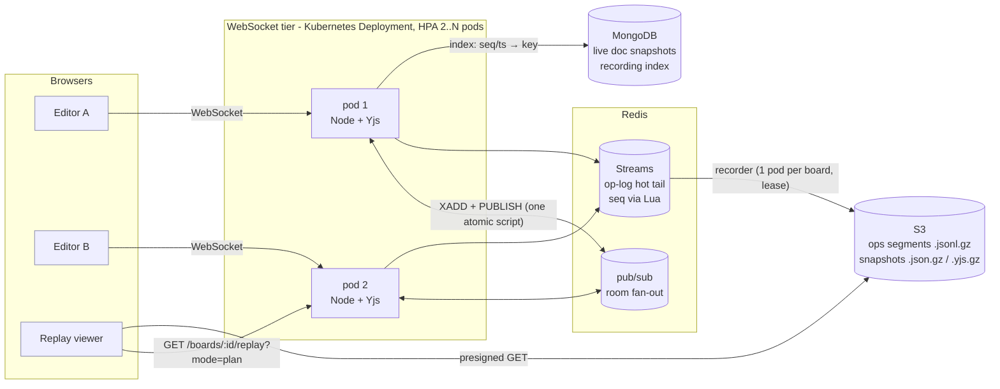
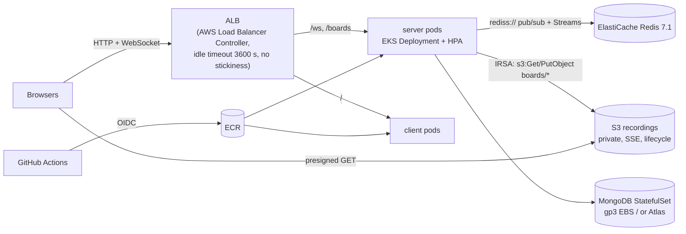

# Real-Time Collaborative Whiteboard

A multi-user whiteboard: CRDT-based conflict resolution, a horizontally scaled WebSocket tier (Redis pub/sub across pods, Kubernetes HPA), automatic offline merge, and **session recording with on-demand replay**: an append-only operation log plus periodic snapshots in S3 lets viewers seek to any point in a session without replaying it from the start.

**Stack:** React + TypeScript + react-konva · Node.js (ws, y-websocket protocol) · Yjs · Redis (pub/sub + Streams) · MongoDB · S3 · Docker · Kubernetes (Helm, HPA)

- [Architecture](#architecture)
- [Recording and replay design](#recording-and-replay-design)
- [Measured results](#measured-results)
- [Running locally](#running-locally)
- [Kubernetes](#kubernetes)
- [Deployment on AWS](#deployment-on-aws)
- [Tests, benchmark and load tests](#tests-benchmark-and-load-tests)
- [API](#api)

## Architecture



| Concern | Approach |
|---|---|
| Concurrent edits | [Yjs](https://github.com/yjs/yjs) CRDT: every client writes locally without locks or central ordering; all replicas converge |
| Horizontal scale | Each pod relays updates from its own clients over a room-scoped Redis pub/sub channel; every pod forwards them to its local clients, so two users in one room can sit on different pods. No sticky sessions |
| Offline / reconnect | Yjs state-vector exchange on reconnect sends only the missing updates; nothing is lost or duplicated |
| Live persistence | Each room's Yjs document is snapshotted to MongoDB (debounced) so a restarted pod can restore it |
| Recording | Every client update gets a per-board **sequence number and server timestamp assigned inside Redis**, is appended to a Redis Stream, then flushed in immutable batches to S3 |
| Replay | Nearest snapshot at or before the target + only the ops after it; browsers download snapshots/segments straight from S3 via presigned URLs |
| Graceful shutdown | SIGTERM fails `/readyz`, drains, closes sockets (clients reconnect to another pod and resync), persists live docs and flushes pending op batches to S3 |

## Recording and replay design

### Recording path

1. **Seq + timestamp on the server, correct across pods.** When a pod receives an update from one of its clients it runs one Lua script on Redis that does `HINCRBY seq` → `TIME` (clamped so it never goes backwards) → `XADD wb:{board}:ops <seq>-0 ts … op …` → `PUBLISH` to the room channel. Because the append and the cross-pod broadcast are one atomic script, no pod can see (and build on) an update before it has a seq, so **seq order always respects causality across pods**. The stream entry ID *is* the seq, so the stream is gap-free and ordered by construction. Keys are hash-tagged (`wb:{board}:…`) so this also works on Redis Cluster / ElastiCache cluster mode.
2. **Append-only op log.** The Redis Stream is the hot tail. A per-board **recorder** reads it in seq order and writes immutable segments `boards/{id}/ops/{startSeq}-{endSeq}.jsonl.gz` (every `SEGMENT_MAX_OPS` ops or `SEGMENT_MAX_AGE_MS`), records them in the index, and only then `XTRIM`s the flushed ops. Objects are never mutated.
3. **Snapshots** every `SNAPSHOT_EVERY_OPS` ops **or** `SNAPSHOT_EVERY_MS` of session time (both configurable), written as two immutable objects:
   - `boards/{id}/snapshots/{seq}.json.gz` – the visible board state (what viewers load)
   - `boards/{id}/snapshots/{seq}.yjs.gz` – the full Yjs CRDT state (exact reconstruction, recorder takeover)
4. **Index in MongoDB**: snapshot `seq → key, ts`; segment `[startSeq, endSeq] → key` and `[startTs, endTs]` (timestamp → seq). A seek never lists the bucket.
5. **One recorder per board** via a Redis lease (`SET NX PX`, renewed each tick). Any pod with the board open competes; if the holder dies another pod takes over within `RECORDER_LEASE_MS`, rebuilds its state from the last snapshot + flushed segments, and continues from the last flushed seq. Unflushed ops just wait in the stream (covered by a test that `SIGKILL`s the holder).

Snapshots are built from a document assembled **only from the log** (apply ops 1..S in seq order), never from a pod's live doc, which can be momentarily ahead of or behind the log. That is what makes "snapshot S + ops (S, k]" provably equal to "replay ops 1..k" (property-tested).

### Seek path

`GET /boards/:id/replay?at=<ms offset>` (or `?seq=<n>`) resolves the target to a seq (timestamp → segment via the index, then a scan of one segment), finds the nearest snapshot at or before it, and applies only the ops between the snapshot and the target.

- `mode=state` (default): the server returns the board at the target.
- `mode=plan`: the server returns **presigned S3 URLs** for the snapshot and the covering segments; the browser downloads and gunzips them itself (`DecompressionStream`), so large objects never stream through Node.
- `exact=1`: reconstruct at the CRDT level (Yjs snapshot + raw ops) and also return the Yjs state, e.g. to fork a board at that point.

**Why two snapshot formats.** The first version loaded Yjs snapshots, and benchmarking showed seek was only ~5x faster than full replay at 50k ops. A Yjs document keeps a tombstone item for every overwritten map value (every shape drag), so *loading the CRDT snapshot itself* is O(session history). The recorder therefore also stores, for each op, its effect on the visible board (shapes set / deleted), computed while applying ops in seq order, next to the raw op in the segment. Viewers start from the visible snapshot and apply those diffs: **O(board size + ops since snapshot), independent of session length**. The raw Yjs ops and CRDT snapshots are still stored, so exact reconstruction remains possible.

### Replay UI

`?room=<id>&replay=1` (or the **Replay** button): play/pause, 1x/2x/4x, a scrubber over the whole session with snapshot tick marks, and **Jump to live**. A debug overlay shows the snapshot each seek used, ops applied after it, segments fetched and seek time. Short forward seeks reuse prefetched ops; playback runs on a virtual session clock (all ops whose timestamp is due are applied each frame) so 4x keeps up with fast edits; idle gaps over 1.5 s are compressed. The scrubber covers what is durable in S3, which lags live by ≤ `SEGMENT_MAX_AGE_MS`.

### Trade-offs: snapshot interval vs storage vs seek latency

From the benchmark below (50k ops, 300-shape board):

| Snapshot every N ops | Snapshot storage | Seek p50 (S3 API) | Ops applied per seek (p50) |
|---|---|---|---|
| 250 | 14.0 MB | 13.4 ms | 156 |
| 1000 | 3.6 MB | 17.3 ms | 513 |
| 5000 | 0.8 MB | 35.6 ms | 3,446 |

- Storage grows as `(session ops / N) × snapshot size`, and snapshot size grows with the board (and, for the CRDT copy, with history). Op segments are a fixed ~1.2 MB per 50k ops regardless of N.
- Seek cost is `snapshot download + up to N diffs`; below N≈1000 it's dominated by fetch latency, not op application, so smaller N buys little.
- The default (N = 1000 or 60 s) keeps worst-case seek work bounded by one interval while costing ~4 MB of snapshots per 50k ops. A lifecycle rule can expire old CRDT snapshots (`*.yjs.gz`) and keep only visible snapshots + segments if exact reconstruction of old sessions isn't needed.
- Recording costs throughput: see the per-pod connection limit with recording on vs off below.

## Measured results

All numbers below were measured in this repo's dev container (Intel Xeon @ 2.8 GHz, 4 vCPU, Node 22.23, Redis 7, MongoDB 7, LocalStack 3.8 for S3). Client and server talk over loopback, so **latencies exclude real network RTT**; add your clients' RTT to the server for user-perceived latency.

### Edit-to-peer sync latency, 10 concurrent editors

`loadtest/sync-latency.ts`: 10 real y-websocket clients in one room, each moving its own shape 10 times/s (100 edits/s, 900 deliveries/s); latency = time from `map.set` on one client to the change applied on each of the 9 others (one process, one monotonic clock). Server pod: 1 vCPU, 512 MB, Redis + Mongo + S3 recording enabled. 3 runs × 60 s each.

| Setup | p50 | p90 | p99 | max | Samples / run |
|---|---|---|---|---|---|
| 1 pod | 1.47–1.63 ms | 2.80–3.34 ms | 5.01–7.66 ms | 10.8–62.4 ms | ~53,800 |
| 2 pods, editors alternated (Redis pub/sub hop for most pairs) | 1.59–1.70 ms | 2.98–3.43 ms | 6.47–7.48 ms | 32.8–58.1 ms | ~53,800 |

No edit was missed by any peer in any run.

### Per-pod connection limit

`loadtest/conn-ramp.ts` ramps connections against **one server instance** while a probe room of 10 real editors measures sync latency at each step.

- **Pod:** Docker container pinned to **one dedicated core** (`--cpuset-cpus=0`, 512 MB), the same `resources` the Helm chart gives a pod. Redis, MongoDB, LocalStack and the load generator run on the other 3 cores.
- **Active load:** connections in rooms of 10; each completes the y-websocket handshake and moves a shape every 5 s (0.2 edits/s per connection, each fanned out to 9 peers). Every step adds 500 connections, settles 5 s, then measures 15 s.
- **Limit:** the first step where probe p99 > 100 ms, > 1% of connections failed or dropped, or the server stops answering.

| Run (active load) | Recording | Last healthy step | First failing step (probe p99) | Server CPU at failing step |
|---|---|---|---|---|
| 1 (quota `--cpus=1`, not pinned) | on | 2,500 | 3,000 (132 ms) | 94% |
| 2 (pinned) | on | 2,500 | 3,000 (212 ms) | 60% |
| 3 (pinned) | on | 1,500 | 2,000 (113 ms) | 47% |
| 4 (pinned) | off | 2,500 | 3,000 (136 ms) | 48% |
| 5 (pinned) | off | 2,000 | 2,500 (109 ms) | 56% |

**Per-pod limit: ~1,500–2,500 actively editing connections per 1-vCPU pod at p99 < 100 ms** (about 300–500 edits/s in, 3,000–5,000 messages/s out). No connection failed or was dropped in any run.

- **What gives out first is tail latency, not CPU.** The server's own event-loop delay max (exported on `/metrics`) rises from ~25 ms to > 100 ms in the same step where the probe p99 fails, while average CPU is still 47–60%. Individual stalls (GC, bursts of fan-out on the single Node thread) are what push p99 over the threshold.
- **Recording overhead is within run-to-run variance at this load** (on: 1,500–2,500; off: 2,000–2,500).
- **The HPA must scale well before that.** CPU is only ~35–45% at 1,500–2,000 connections, so the chart's HPA target is **40% CPU** (60% would scale out only after p99 had already failed).

**Idle-connection capacity** (connections complete the handshake, then send nothing; 1,000 per step; 1 run): **13,000 idle connections per pod** at probe p99 < 100 ms with 0 failures, server RSS 191 MB, CPU 31%. The 14,000 step failed on a single 142 ms server event-loop stall (CPU 25%), not on memory or file descriptors. This sandbox caps a process at 20,000 file descriptors, so nothing above ~19.9k could have been tested anyway. Connecting 2,000 at once (3,000/s) made ~4% of handshakes fail; the pod handles connect bursts of 500–1,000 cleanly.

Raw results (JSON per step) are produced with `--json`; the generator also reports its own event-loop delay, so a stalled generator can't masquerade as a slow server.

### Seek latency: snapshot + ops vs full replay

`bench/seek-bench.ts`: a 50,000-op session from 6 simulated editors (300-shape board), recorded through the real recorder into the S3 API (LocalStack), then 30 random seeks per configuration. Every seek is cross-checked: all four paths must produce identical boards.

| Snapshot every N ops | Snapshot storage (visible + CRDT) | **Seek: snapshot + ops** p50 / p95 / max | Ops applied (p50) | Bytes read (p50) | Full replay from seq 0 p50 / p95 / max | Bytes read (p50) | Speedup (p50) |
|---|---|---|---|---|---|---|---|
| 250 | 14.0 MB | **13.4 / 17.8 / 20.7 ms** | 156 | 15 KB | 389 / 740 / 762 ms | 1,191 KB | **29x** |
| 500 | 7.0 MB | **13.5 / 17.1 / 56.5 ms** | 267 | 25 KB | 248 / 455 / 465 ms | 1,153 KB | **18x** |
| 1000 | 3.6 MB | **17.3 / 23.5 / 84.1 ms** | 513 | 43 KB | 254 / 478 / 494 ms | 1,153 KB | **15x** |
| 2000 | 1.8 MB | **22.3 / 28.2 / 29.0 ms** | 1,318 | 67 KB | 269 / 459 / 460 ms | 1,153 KB | **12x** |
| 5000 | 0.8 MB | **35.6 / 66.5 / 73.1 ms** | 3,446 | 139 KB | 271 / 516 / 530 ms | 1,153 KB | **8x** |

Scaling to a **200,000-op** session (N = 1000, 15 seeks): snapshot seek p50 **19.5 ms** vs full replay p50 **1,085 ms** (**56x**). Seek time stays flat as the session grows (17.3 → 19.5 ms from 50k → 200k ops) while full replay grows linearly.

For reference, the exact CRDT path (Yjs snapshot + raw ops) at 50k ops / N = 1000: seek p50 49.6 ms vs full replay 372 ms; at 200k ops: 148 ms vs 1,660 ms. It is slower because loading a Yjs snapshot is O(history) (see above).

Against real S3 each GET adds tens of ms of first-byte latency. A snapshot seek needs 2–3 GETs; a full replay needs one per segment (100 at 50k ops, fetched 8 at a time). So the gap should be larger on AWS, but that has not been measured here.

## Running locally

Everything runs without AWS; S3 is emulated by LocalStack.

```bash
docker compose up --build
# open http://localhost:5173/?room=demo  - draw, then hit "Replay"
```

Generate a session to replay:

```bash
cd server && npm install
npx tsx scripts/seed-session.ts --url ws://localhost:1234 --room demo --ops 2000
```

Dev mode (hot reload). Each dependency is optional: no Redis → single-instance mode; no Mongo → in-memory index; no S3 → in-memory object store.

```bash
docker compose up -d redis mongo s3
cp server/.env.example server/.env   # then: set -a; . server/.env; set +a
cd server && npm run dev             # ws://localhost:1234
cd client && npm install && npm run dev   # http://localhost:5173/?room=demo
```

Horizontal-scaling demo with 3 server containers behind a round-robin nginx (no sticky sessions):

```bash
docker compose -f docker-compose.yml -f docker-compose.scale.yml up --build --scale server=3
```

All configuration is documented in [`server/.env.example`](server/.env.example).

## Kubernetes

[`deploy/helm/whiteboard`](deploy/helm/whiteboard) deploys the WebSocket tier and the client:

- server `Deployment` with **HPA** (CPU 40%, chosen from the load test; 2–10 replicas, fast scale-up / slow scale-down to avoid reconnect flapping), `PodDisruptionBudget`, topology spread across nodes
- **liveness** `/healthz` (never depends on Redis/Mongo, so a Redis blip doesn't restart every pod), **readiness** `/readyz` (checks Redis + Mongo, flips to 503 on SIGTERM), startup probe
- `terminationGracePeriodSeconds` > drain + flush time, rolling updates with `maxUnavailable: 0`
- non-root, read-only root filesystem, all capabilities dropped
- the server pod's `resources` match the load-test pod (1 vCPU, 512 MB), so the measured per-pod limit applies directly
- optional Ingress: `/ws/<room>` and the API → server, `/` → client

Local cluster (kind / minikube / Docker Desktop):

```bash
docker build -t whiteboard-server:dev server
docker build -t whiteboard-client:dev --build-arg VITE_WS_URL=ws://localhost:1234 --build-arg VITE_API_URL=http://localhost:1234 client
kind load docker-image whiteboard-server:dev whiteboard-client:dev   # kind only
kubectl apply -f deploy/k8s-local/deps.yaml
helm install wb deploy/helm/whiteboard -f deploy/helm/whiteboard/values-local.yaml
kubectl port-forward svc/wb-whiteboard-server 1234:1234 & kubectl port-forward svc/wb-whiteboard-client 5173:80 & kubectl port-forward svc/localstack 4566:4566 &
```

The HPA needs metrics-server (`kubectl apply -f https://github.com/kubernetes-sigs/metrics-server/releases/latest/download/components.yaml`; on kind add `--kubelet-insecure-tls`).

## Deployment on AWS

Infrastructure as code for EKS + ElastiCache + S3 lives in [`infra/terraform`](infra/terraform); the step-by-step guide, cost estimate (≈ $0.30/h) and teardown are in **[docs/aws-deploy.md](docs/aws-deploy.md)**.



| Piece | Where |
|---|---|
| VPC, EKS (managed nodes, metrics-server, EBS CSI), ElastiCache, S3 bucket + lifecycle + CORS, IRSA roles, ECR, GitHub OIDC role | `infra/terraform/*.tf` |
| EKS values: ALB ingress for WebSockets, `/readyz` health checks, IRSA ServiceAccount, Mongo secret | `deploy/helm/whiteboard/values-eks.yaml` (+ `terraform output -raw helm_values`) |
| MongoDB StatefulSet for the demo | `deploy/k8s-aws/mongo.yaml` |
| CI: tests (incl. Redis + Mongo + S3 API), client build, `helm lint`, `terraform validate`; image push to ECR via OIDC on tags | `.github/workflows/` |

Pods never hold AWS keys: the S3 client uses the SDK's default credential chain, which picks up the IRSA web-identity token on EKS. Locally, the same code talks to LocalStack through `S3_ENDPOINT`.

## Tests, benchmark and load tests

```bash
cd server
npm test        # unit + property + multi-instance tests (needs redis-server on PATH for the 2-instance tests)
# opt-in end-to-end test on real Redis + MongoDB + S3 API, 2 server instances:
TEST_S3_ENDPOINT=http://localhost:4566 TEST_MONGO_URL=mongodb://localhost:27017 npm test
cd ../e2e && npx playwright install && npm test   # two real browsers editing one room
```

| Test | What it proves |
|---|---|
| `replay.property.test.ts` | fast-check, 60 random cases: for random sessions (1–5 editors, up to 250 ops), random snapshot/segment settings and random interleavings of appends and recorder runs, **snapshot + ops up to k == replaying all ops 0..k**, for the exact CRDT path and the viewer path, and a seek never applies more than one snapshot interval of ops |
| `seek.test.ts` | 20,000-op session: exact state at any seq in random seek order, < 500 ops applied per seek; `?at=` ms offsets resolve to the last op at or before that time |
| `multi-instance.test.ts` | 2 server processes on one Redis, 10 clients editing concurrently: gap-free seqs 1..400, non-decreasing timestamps, log replay == live state; ping/pong across pods proves causal order |
| `full-stack.test.ts` | Redis + Mongo + S3 API, 2 pods: segments/snapshots land in S3, either pod seeks correctly, presigned URLs work, and a surviving pod takes over recording after the lease holder is `SIGKILL`ed without losing ops |
| `integration.test.ts` | concurrent-edit convergence and offline-edit merge on reconnect |

Benchmark and load tests:

```bash
npx tsx bench/seek-bench.ts                       # add S3_ENDPOINT/S3_BUCKET/AWS_* to use an S3 API
npx tsx loadtest/sync-latency.ts --urls ws://localhost:1234,ws://localhost:1235 --editors 10 --rate 10 --duration 60
npx tsx loadtest/conn-ramp.ts --url ws://localhost:1234 --step 500 --max 6000 --edit-interval 5000 --docker <server-container>
```

## API

| Endpoint | Description |
|---|---|
| `GET /boards/:id/replay?at=<ms>` \| `?seq=<n>` \| `?at=seq:<n>` | Board state at that point (`mode=plan` → presigned URLs; `exact=1` → CRDT-level, includes Yjs state) |
| `GET /boards/:id/timeline` | session start, live head, last flushed seq, snapshot list |
| `GET /boards/:id/ops?after=<seq>&to=<seq>` | presigned segment URLs for playback buffering |
| `GET /healthz` · `GET /readyz` · `GET /metrics` | liveness · readiness · connections, rooms, RSS, event-loop delay, recorder status |
| `ws://host/<room>` or `ws://host/ws/<room>` | y-websocket protocol |

## Project layout

```
server/src/
  index.ts              HTTP + WebSocket entry, graceful shutdown
  ws-handler.ts         y-protocols sync + awareness per connection
  room.ts               one Y.Doc per room; records ops, relays via Redis
  redis-adapter.ts      cross-pod pub/sub
  persistence.ts        live-doc snapshots in MongoDB
  http-api.ts           replay / timeline / health endpoints
  recording/
    op-log.ts           Redis Streams hot tail, Lua seq assignment, recorder lease
    recorder.ts         hot tail -> S3 segments + snapshots
    replay.ts           seek: snapshot + ops; presigned plans; ts -> seq
    index-store.ts      MongoDB index of snapshots/segments
    object-store.ts     S3 (any S3 API) / in-memory
server/test, server/bench, server/loadtest, server/scripts
client/src/replay/      ReplayPlayer (seek/playback engine), ReplayView (UI)
deploy/helm/whiteboard  Helm chart (HPA, probes, PDB, ingress)
deploy/k8s-local        throwaway Redis/Mongo/LocalStack for local clusters
```

## Known limitations / next steps

- **Auth**: any room id can be joined and replayed; production needs JWT + room membership checks on both the WebSocket and the replay API.
- **Rendering**: react-konva redraws the whole layer; boards with thousands of shapes should split static and dragged shapes into separate layers.
- **Replay lags live** by up to `SEGMENT_MAX_AGE_MS` (the viewer only plays what is durable in S3); `?exact=1` on the API covers the unflushed tail.
- **Live-doc snapshot in Mongo** is a full `Y.encodeStateAsUpdate` and grows with history (same tombstone effect as above); periodic compaction would need a coordinated doc swap across pods.
